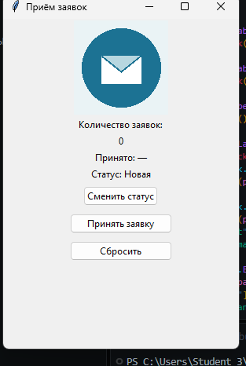

# [Название программы]

Автор: Лиза Шишкова,Куницына Анастасия ,Светикова Виктория
Группа: 11Тэс 
Версия программы: 0.2.1 

## Назначение
Программа предназначена для учёта заявок: она считает количество принятых заявок,
записывает время приёма и позволяет отслеживать статус каждой заявки.
Подходит для учебного стенда или небольшой точки приёма, где нужно вести
простой счётчик без базы данных. Задачи, которые решает программа:
- счёт принятых заявок с ограничением — не более 10 в день;
- фиксация даты и времени приёма последней заявки;
- циклическое изменение статуса: Новая → В работе → Готово;
- сброс счётчика для начала нового рабочего дня
## Запуск
Программа запускается на учебном компьютере с установленным Python 3.
Файл программы `main.py` и файл `logo.png` лежат в одной папке.
Запуск выполняется двойным щелчком по файлу или в терминале:После запуска открывается окно размером 300×420 с заголовком
«Приём заявок», логотипом, счётчиком, датой приёма и тремя кнопками.

## Проверка заявки
1. Нажимаем кнопку «Принять заявку» три раза подряд.
2. Проверяем результат: счётчик последовательно показывает 1, 2, 3,
   под счётчиком появляется дата и время приёма последней заявки,
   например «Принято: 09.11.2026 09:50».
3. Нажимаем «Принять заявку» ещё семь раз — всего десять.
4. Проверяем результат: после десятой заявки счётчик показывает «Лимит: 10»,
   кнопка «Принять заявку» становится неактивной — заявку принять нельзя.

## Смена статуса
Действие: нажимаем кнопку «Сменить статус».
Результат: надпись меняется по кругу — «Статус: Новая» → «Статус: В работе» →
«Статус: Готово» → снова «Статус: Новая». Смена статуса не зависит от
количества заявок, кнопка не блокируется.

## Сброс счётчика
Действие: нажимаем кнопку «Сбросить».
Результат: счётчик становится равен 0, дата возвращается к «Принято: -»,
кнопка «Принять заявку» снова активна.
Важное ограничение: предыдущее значение счётчика не сохраняется,
восстановить его после сброса нельзя.

## Скриншот

## Если возникло затруднение
- Ситуация 1: при запуске появляется ошибка
  `TclError: couldn't open "logo.png"`.
  Решение: положить файл `logo.png` в ту же папку, где лежит `main.py`,
  и проверить точное совпадение имени файла.
- Ситуация 2: после десяти заявок кнопка «Принять заявку» не реагирует.
  Решение: это не ошибка, а ограничение программы. Нажимаем «Сбросить» —
  кнопка разблокируется, счётчик обнуляется, приём заявок продолжается.
## Результат проверки
Проверяющий: Светикова Виктория

По мануалу выполнены все действия: запущена программа, принято десять заявок
с проверкой счётчика и даты, проверена блокировка кнопки после десятой
заявки, проверена циклическая смена статусов и выполнен сброс счётчика.
Все результаты совпали с ожидаемыми: счётчик считает корректно, лимит
в десять заявок соблюдается, статусы меняются по кругу, сброс возвращает
программу в начальное состояние. Изображение в отчёте проверено:
скриншот соответствует работающей программе. Вопросов по ходу проверки
не возникло.

## Доработка
Правки кода не понадобились: при первой проверке программа отработала все
сценарии без ошибок. Единственное изменение — файл `logo.png` был добавлен
в папку проекта после ошибки запуска (Ситуация 1), после чего программа
запустилась корректно и скриншот был снят заново.
